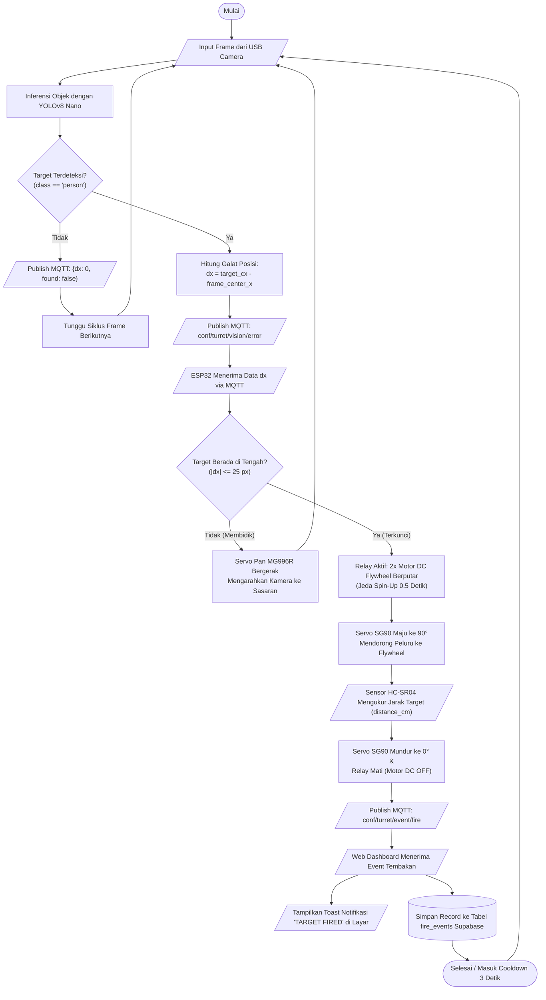
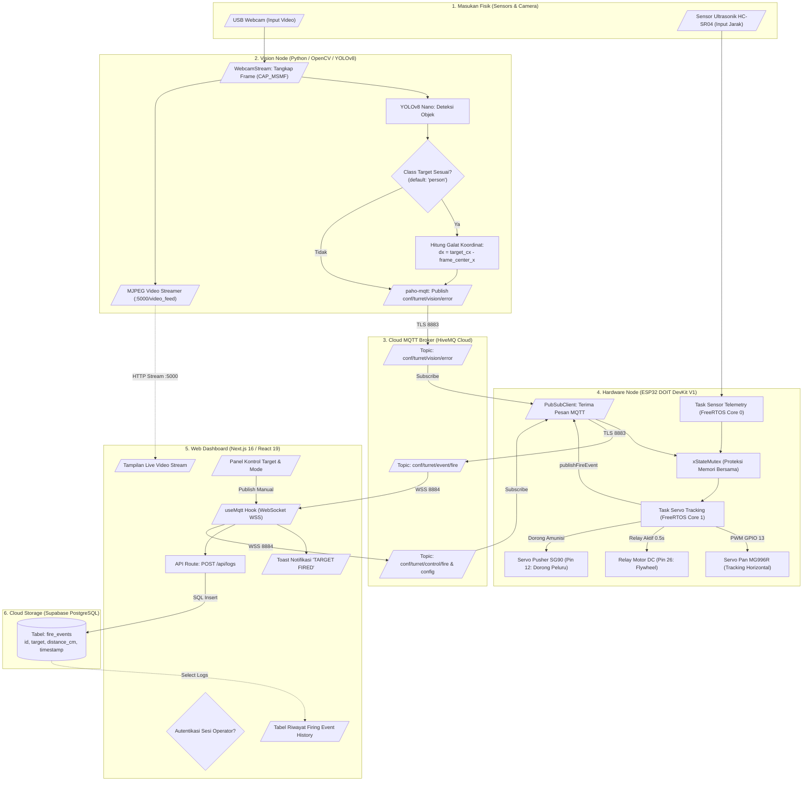
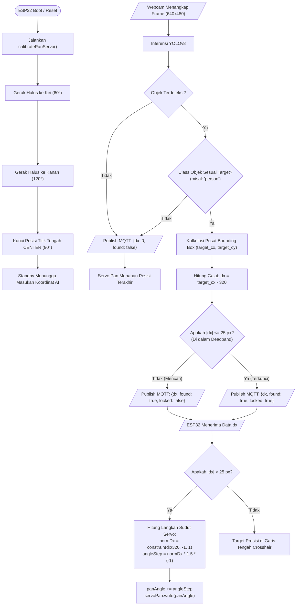
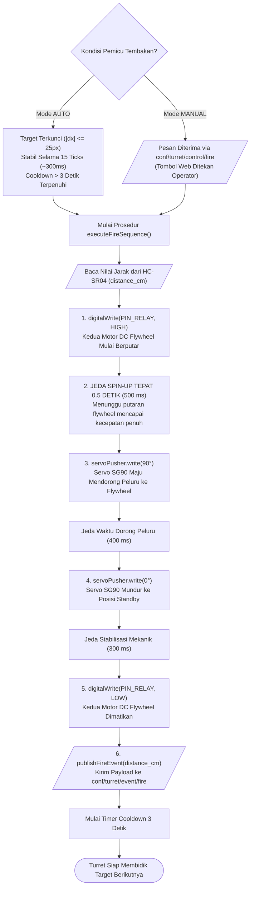
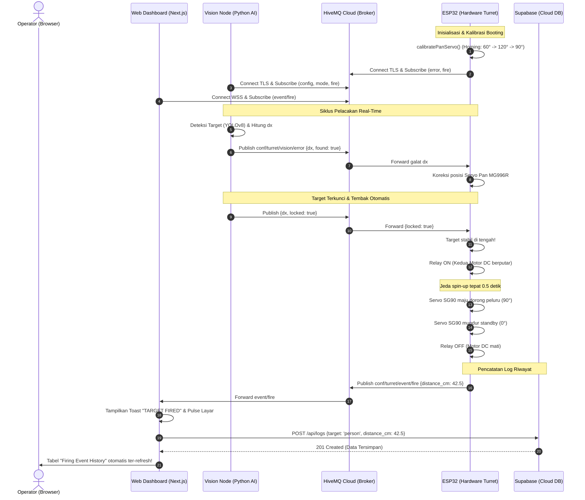

# 📊 Diagram Alur Sistem (System Flowchart) — Auto-Aiming Turret

> Dokumen ini berisi diagram alur sistem Auto-Aiming Turret yang telah distandardisasi mengikuti **Standar Notasi Flowchart Internasional (ANSI / ISO 5807)**.

---

## 📌 Standar Simbol Flowchart yang Digunakan (ANSI / ISO 5807)

| Simbol Mermaid | Bentuk Geometri | Makna Standar ANSI/ISO | Contoh Penggunaan di Proyek |
|---|---|---|---|
| `([ Teks ])` | **Oval / Kapsul (Terminator)** | Titik Awal (*Start*) atau Titik Akhir (*End*) sistem | `([Mulai])`, `([Selesai])` |
| `[ Teks ]` | **Persegi Panjang (Process)** | Operasi komputasi, kalkulasi, atau aksi aktuator mekanik | `[Hitung Galat dx]`, `[Relay ON]` |
| `{ Teks }` | **Belah Ketupat (Decision)** | Percabangan logika kondisi keputusan (*Ya / Tidak*) | `{Target Terkunci?}`, `{Objek Ditemukan?}` |
| `[/ Teks /]` | **Jajar Genjang (Input/Output)** | Masukan data sensor/kamera atau transmisi data I/O MQTT | `[/Input Frame Kamera/]`, `[/Publish MQTT/]` |
| `[( Teks )]` | **Silinder (Data Storage)** | Penyimpanan data persisten / basis data (*Database*) | `[(Tabel fire_events Supabase)]` |

---

## ⚡ 0. Flowchart Ringkas Alur Keseluruhan Sistem (Standar ANSI/ISO)

Diagram di bawah ini merangkum seluruh siklus kerja sistem secara padat, dari input kamera fisik hingga penyimpanan log di database, dengan simbol standar:

---

## 🏗️ 1. Flowchart Arsitektur Menyeluruh & Alur Data (End-to-End)

Diagram detail yang memperlihatkan arsitektur berlapis (*layered architecture*) antar 6 subsistem:

---

## 🎯 2. Flowchart Alur Pelacakan AI & Kalibrasi Servo

Diagram logika pendeteksian target dan kendali putaran servo pan:

---

## ⏱️ 3. Flowchart Sekuens Penembakan (Timing Diagram)

Diagram waktu presisi relay motor DC dan servo peluru SG90:

---

## 🔄 4. Sequence Diagram Interaksi Antar-Komponen

